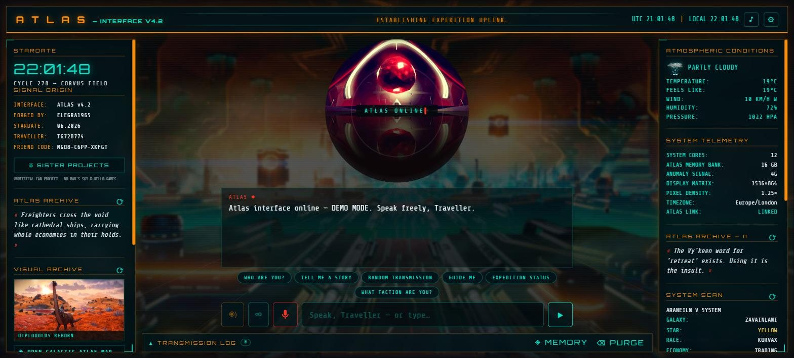
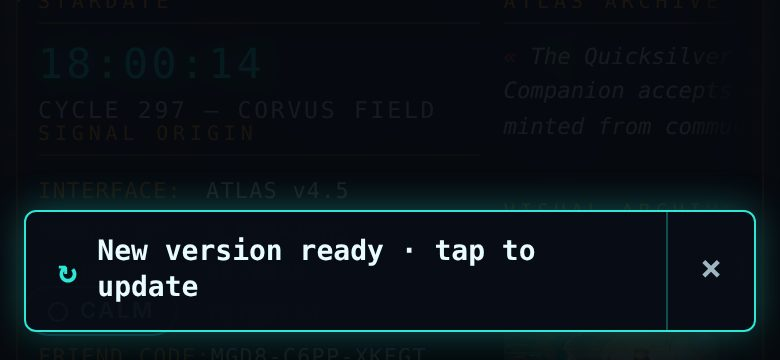
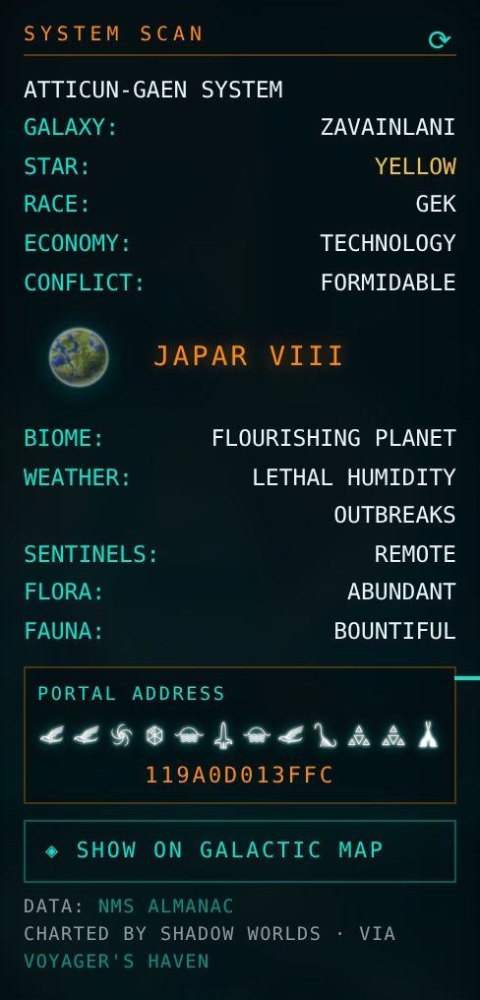
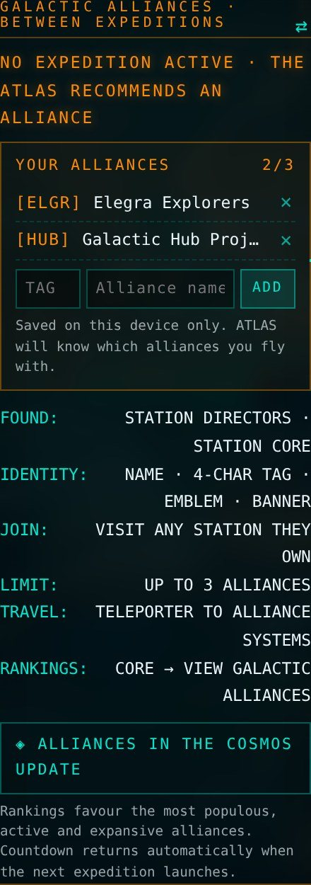
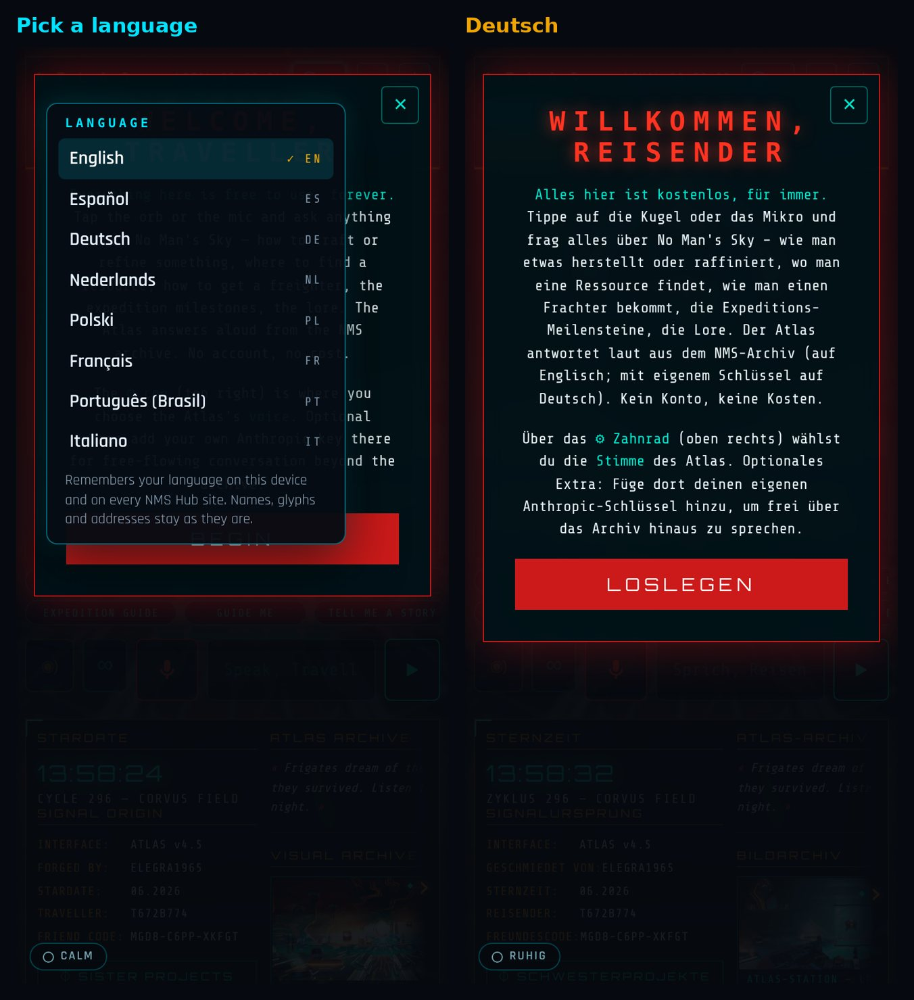
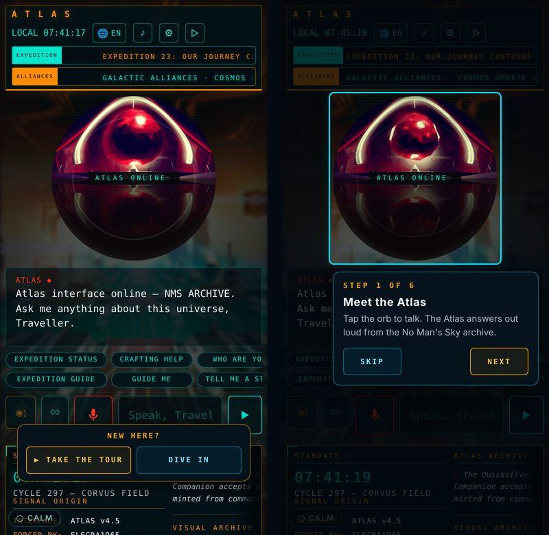

# ATLAS — No Man's Sky AI Interface

**Live:** [atlas.nomansskyhub.app](https://atlas.nomansskyhub.app)

A voice-first AI companion themed on *No Man's Sky*. Speak to the Atlas and it speaks back, with a live HUD around it: the current expedition, real community-charted worlds, your local weather and lore from across the universe. Free for everyone with no key: the NMS Archive answers No Man's Sky questions from built-in lore and the live NMS Wiki (in English), at no cost. Add your own Anthropic API key and ATLAS becomes a true AI that can talk about anything, in your language.

Part of the [No Man's Sky Hub](https://nomansskyhub.app) family of fan tools.

**Contents** — long sections are folded; tap to open.

- [Highlights (v4.5)](#highlights-v45)
- [New here? Take the tour](#new-here-take-the-tour)
- [Where the code is](#where-the-code-is)
- [Using this code?](#using-this-code)
- [Licence](#licence)
- [Credits](#credits)

<!-- folded -->

## Highlights (v4.5)

▸ Tap to open

- **Expedition alerts and Traveller ID.** 🔔 EXPEDITION ALERTS under the countdown turns on new-expedition / ends-in-24h notifications from ATLAS itself, in your language (`nms-push.js`; sent by the Weather station's alert server), and ATLAS greets you by the Traveller ID name saved on the Hub.
- **Atlas Codex:** ask how to craft or refine anything, where to find it, or what an item is used for — real recipes and sources read live from the [No Man's Sky Wiki](https://nomanssky.fandom.com), no API key needed
- **Expedition guide:** every milestone of the current expedition by phase, with hints and rewards
- **Voice in, voice out**, with wake word, continuous mode, hold-to-talk and interruptions
- **Long-term memory** of what you tell it about yourself, stored only in your browser
- **Community Research, live.** The ticker shows the Space Anomaly's Community Research tier and progress (e.g. *Tier 2 of 2 — 41%*), the same figure as Hello Games' [Galactic Atlas](https://galacticatlas.nomanssky.com/poi/community-research) sidebar, and you can ask ATLAS *"what's the community research at?"*, with or without a key.
- **Live expedition ticker and countdown** from the official Galactic Atlas feed. It finds new expeditions by itself
- **Galactic Alliances tile** with the live top 5 in the left panel (on phones it sits where the Visual Archive was; both archives now share one tile)
- **Live alliance leaderboard ticker** under the expedition ticker: the top 10 Galactic Alliances with members, stations and 24-hour changes, plus where your own alliances rank. Leaderboard courtesy of [Voyager's Haven](https://havenmap.online), built by [u/IAmThe-Ekimo-1920](https://www.reddit.com/user/IAmThe-Ekimo-1920/)
- **Real worlds in the System Scan, straight from the game.** Voyager's Haven picks a random player-charted system; [NMS Almanac](https://nmsalmanac.com) (by Borjomi) then fills in what the game itself says about it: system and planet names, star, race, economy, conflict, biome, weather, sentinels, flora, fauna, and the Almanac's picture of the planet. Each ⟳ picks another system and a random planet in it. The portal address (glyphs + hex) points at that exact planet, and **◈ SHOW ON GALACTIC MAP** takes you there. If the Almanac doesn't know a system, the scan falls back to Haven's own data; if a traveller uploaded a photo to Haven, it shows too. Credited under the scan: *Data: NMS Almanac* (links to the planet's Almanac page) and *Charted by … via Voyager's Haven*. Almanac answers come through the Galactic Map's cached Almanac lookup, so the Almanac key never reaches the browser.
- **Captions that fit.** The glyph + English captions while ATLAS speaks always show whole lines (never half a line). While they're up, the question bar and quick chips step aside, and the orb (then the glyph line) shrinks on short screens, so all 3 English lines always show. The box closes 1 second after the last word (or straight away on End Transmission / an orb tap), and the question bar fades back in. The Transmission Log bar then glows and says *◂ Full transmission saved here* for a few seconds, so you know where the whole answer went.
- **Galactic Alliances.** Between expeditions the countdown panel becomes an alliances briefing. Log up to three of your own alliances and ATLAS knows who you fly with
- **Phone-friendly**, with arrows that show when a tile strip scrolls sideways
- **Calm mode.** A small **Calm** switch in the bottom-left corner swaps the patterned and image backgrounds for a plain dark one, for anyone who finds the page busy. It's shared across the whole No Man's Sky Hub family (one switch turns it on for every site) and lives in `atlas-nms-assistant/calm.js`.
- **Your language.** The 🌐 button switches the page between English, Español, Deutsch, Nederlands, Polski, Français, Português (Brasil) and Italiano. With your own key, ATLAS answers in your language, and the voice and microphone use it too (free voices built into your device; if it has none for your language, ATLAS says so and speaks English). Answers from the free NMS Archive stay in English, with a note saying so. The choice is shared by the whole No Man's Sky Hub family: pick it once and every site follows (a small cookie on `.nomansskyhub.app`; when you pick a language, an anonymous count of which one is sent to the site's cookie-free GoatCounter stats, so we can see which languages people use). On a first visit the page offers your phone's language once instead of switching by itself. Names, glyphs and portal addresses stay as they are. It lives in `atlas-nms-assistant/lang.js` (the same file on every site), with one small pack per language in `lang/` and a font for Polish letters in `fonts/`.
- **Always the newest version.** An installed app on a phone isn't reloaded when you switch back to it, so it could keep showing an old version until it was closed and reopened. Now, each time you come back to it (and every 30 minutes while it stays open), it checks for a new version. If one is live, a small bar says “New version ready · tap to update”, in your language. One tap reloads in place; × hides it. It never reloads by itself, so nothing you're in the middle of is lost. It lives in `nms-update.js`, the same file on every site. ATLAS now turns on its own offline/update worker (`sw.js`) for everyone, not only when alerts are on, so this works here too.
- **⟳ Refresh.** In the installed app there's no browser reload button (and pull-to-refresh doesn't work everywhere), so a small ⟳ button sits next to the language button. Tap it and it checks for a new version and reloads in place, on the same view. It only shows in the installed app. After a big batch of updates, the first open on that day says “✓ Updated · that's the last update today”, so nobody wonders if more pop-ups are coming. The old nms-atlas-interface-ai.netlify.app address now sends search engines here with a permanent (301) redirect.
- **Share on Discord.** Under the expedition countdown the share row is X, Reddit and Discord (it replaced Copy link). Discord has no share link, so the button copies a short message with the link, says “Copied — paste it in any server or DM” and opens Discord so you pick where to post it.

  

  
  

## New here? Take the tour

First-time visitors get a small **New here? ▶ Take the tour / Dive in** box (shown once, never again). The tour dims the page and spotlights the orb, tap to speak, typing, quick questions, settings and the transmission log, one step at a time with Back / Next / Skip. Replay it any time from the **▷** button next to the cog button. The phone's Back button closes it, and it's translated into every language the site offers. Shared `nms-tour.js`, the same file on every nomansskyhub.app site.

## Where the code is

The whole site lives in [`atlas-nms-assistant/`](atlas-nms-assistant/). That folder's [README](atlas-nms-assistant/README.md) covers setup, controls, voices, the API key and every file. Netlify publishes that folder on every push to `main`.

## Using this code?

It's free to use under the MIT licence. If you use any of it in your own project, site, video or post, please credit **elegra1965 / No Man's Sky Hub** with a link to [nomansskyhub.app](https://nomansskyhub.app). The MIT licence also asks you to keep the copyright notice in `LICENSE` with any copied code.

## Licence

The code is MIT licensed (see `atlas-nms-assistant/LICENSE`). Game names and imagery belong to Hello Games and are not covered by that licence.

*An unofficial, fan-made project. Not affiliated with, sponsored by, or endorsed by Hello Games or Anthropic.*

## Credits

- Live expedition data: the official Galactic Atlas API by Hello Games
- Recipes, sources and expedition milestones: the [No Man's Sky Wiki](https://nomanssky.fandom.com) community (CC BY-SA)
- Real planet and system data + planet pictures in the System Scan: [NMS Almanac](https://nmsalmanac.com) by Borjomi. Thanks for the API.
- Real worlds and the alliance leaderboard: [Voyager's Haven](https://havenmap.online), built and run by [u/IAmThe-Ekimo-1920](https://www.reddit.com/user/IAmThe-Ekimo-1920/). Thanks for opening up the Haven API. Haven's data belongs to Haven and its contributors.

Built by elegra1965.
